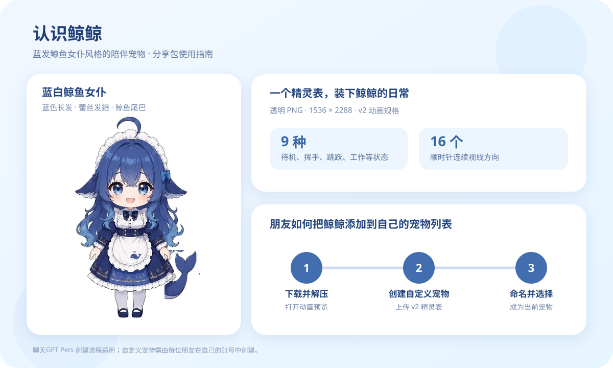

# 鲸鲸｜ChatGPT 宠物分享包

蓝发鲸鱼女仆风格的陪伴宠物，取材自蓝白 Q 版鲸鱼娘形象。

## 使用

下载 [鲸鲸-分享安装包.zip](./鲸鲸-分享安装包.zip) 并解压。包内包含可上传的透明 v2 精灵表、9 种状态与 16 个视线方向的动画预览，以及验收资料。可在支持 ChatGPT Pets 的 ChatGPT Work 环境中创建自定义宠物：名称填写「鲸鲸」，描述填写「蓝发鲸鱼女仆风格的陪伴宠物」，随后将新宠物设为当前宠物。

宠物记录归创建它的 ChatGPT 账号所有；下载此包的朋友需要在自己的账号中创建，才能将其添加到自己的宠物列表。此仓库公开，任何人都可以访问其中的素材。
